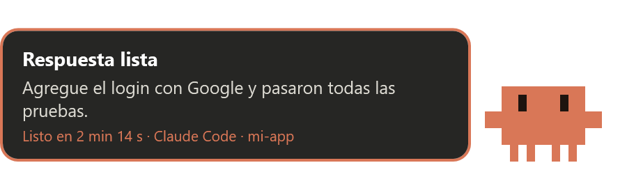
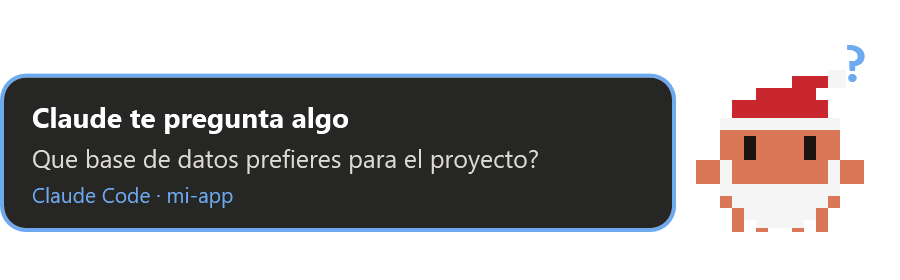
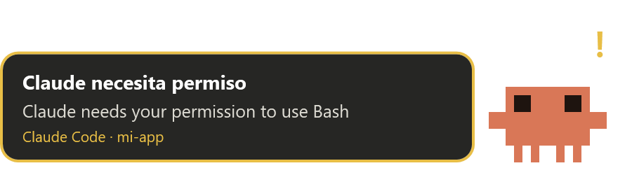
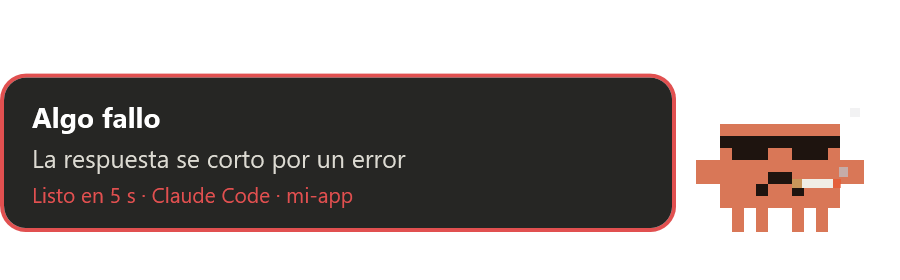

# Notificaciones interactivas para Claude Code

Un mod para Windows que reemplaza los avisos de Claude Code por una mascota en pixel art. Entra caminando por la esquina inferior derecha de la pantalla con un globo de texto que te dice qué pasó:

- **Respuesta lista**: un ultraresumen de lo que hizo Claude y cuánto tardó.
- **Pide permiso**: ojos bien abiertos y un **!** encima.
- **Te pregunta algo**: un **?** flotando sobre la cabeza.
- **Algo falló**: cara triste y globo rojo.





## Qué hace

- **Te lleva de vuelta**: haz clic en la mascota y se abre la ventana de donde vino el aviso, sea la app de escritorio, la terminal o VS Code. Si estaba minimizada la restaura; si la app estaba cerrada en la bandeja, la abre.
- **No molesta**: si ya estás mirando esa ventana, no aparece.
- **Tiene vida propia**: saluda, parpadea y bosteza. Si no le haces caso se sienta, cabecea y se queda dormida (z z z). Al irse se levanta y sale caminando.
- **Cambia cada vez**: expresiones y accesorios al azar (gorro de Navidad, de fiesta, sombrero de bruja, lentes con cigarro).
- **Suena suave**: una gota al terminar, un pop cuando te necesita. Se generan al vuelo, sin archivos de audio.
- **Se apila**: si terminan varias sesiones a la vez, las mascotas salen una encima de otra.

| Pide permiso | Algo falló |
| --- | --- |
|  |  |

## Instalación

> [!TIP]
> ### La forma más fácil: pídeselo a Claude
>
> Abre Claude Code (la app de escritorio, la terminal o VS Code), copia este mensaje, pégalo en el chat y envíalo:
>
> ```text
> Instala el plugin interactive-notify del marketplace de GitHub mark-quispe/claude-interactive-notify, con alcance de usuario.
> ```
>
> Claude hace el resto. Te pedirá permiso antes de ejecutar los comandos: acéptalo. Cuando termine, **abre una sesión nueva**, mándale un mensaje y cambia a otra ventana mientras responde: la mascota aparecerá al terminar.

### Requisitos

- Windows 10 u 11. Usa Windows PowerShell, que ya viene con Windows.
- Claude Code: la app de escritorio, la CLI en la terminal o la extensión de VS Code.

### Otras formas de instalarlo

En el prompt de una sesión de Claude Code en la terminal:

```
/plugin install interactive-notify --marketplace mark-quispe/claude-interactive-notify
```

Responde `y` para agregar el marketplace y elige el alcance (usuario, para todas tus sesiones).

Desde una terminal:

```bash
claude plugin install interactive-notify --marketplace mark-quispe/claude-interactive-notify
```

En la app de escritorio, donde `/plugin` no funciona: haz clic en **+** junto al cuadro de texto, luego **Plugins**, **Add marketplace** con `mark-quispe/claude-interactive-notify`, y después **Add plugin**.

La mascota aparece en una sesión nueva.

> [!NOTE]
> Si en la app de escritorio tienes activadas sus propias notificaciones, saldrán los dos avisos. Para quedarte solo con la mascota, desactiva **Task complete notifications** en la configuración de la app.

## Desinstalar

```bash
claude plugin uninstall interactive-notify
```
